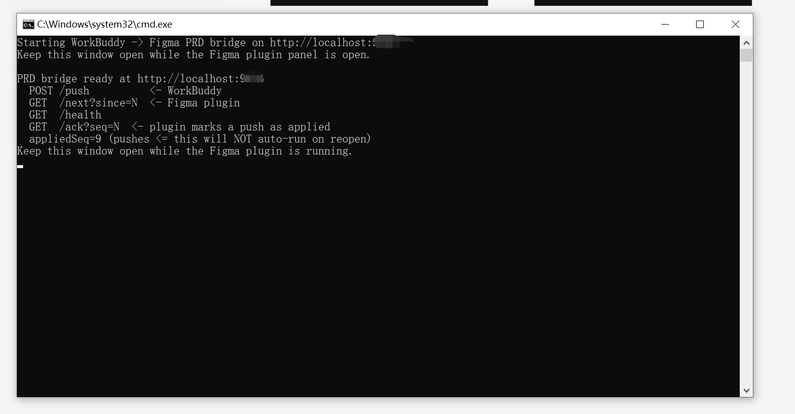
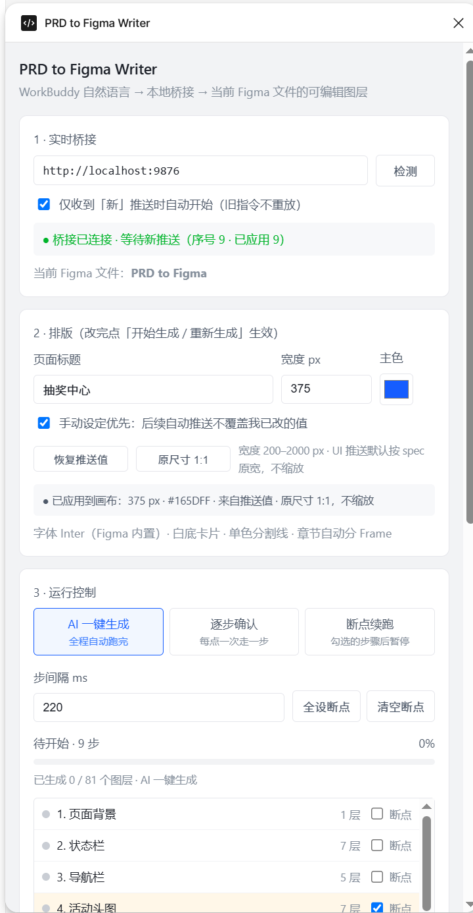
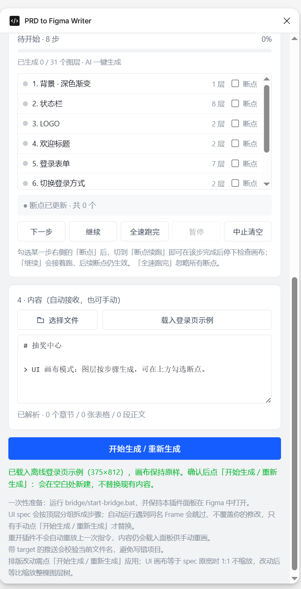
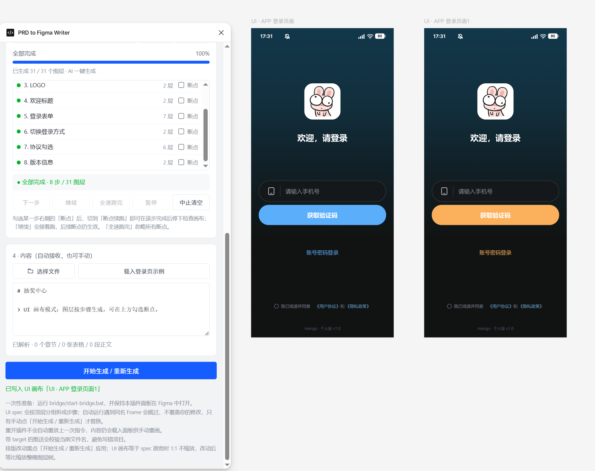

# PRD to Figma Writer

> 在 WorkBuddy 里说一句自然语言，内容自动流进**当前打开的 Figma 文件**，生成可逐个编辑的原生图层（Frame / Text / Rect / Vector / Image），不是截图。
> v1.0.0 · 零第三方依赖 · 纯 JS · 无需 npm install · 无需构建

---

## 1. 它是干什么的

Figma REST API 对设计内容只有 GET、没有写；官方远程 MCP 又要求 Catalog 白名单客户端 + OAuth。所以本方案走**本地桥接 + Figma 插件**：

```
WorkBuddy 自然语言
   ↓ 生成 Markdown（文档）或 uispec.json（UI 图层树）
bridge/push.js  ──POST /push──▶  localhost:9876（Node 零依赖 HTTP 服务）
                                     ↓  GET /next?since=N（每 1.2s 轮询）
                              Figma 插件面板 ui.html
                                     ↓  Plugin API 消息
                              code.js 写入当前 Figma 文件
                                     ↓
                          可编辑的原生图层 + 进度/断点/防覆盖
```

| 输入 | 输出 |
|---|---|
| `.md` / `.txt` / `.html` 文档 | 标题、章节 Frame、表格行列、引用色条、代码块、列表 |
| `*.uispec.json` 图层树 | 完整页面画布：Frame / Text / Rect / Ellipse / SVG 矢量 / 位图 / 渐变 |

**两条能力边界**（别踩）：
- 只能写**当前打开的 Figma 文件**，不能跨文件路由；`--target` 是按文件名校验的保护，不是传送门。
- 插件面板必须保持打开，它是唯一接收端；关掉就没人取件。

---

## 2. 目录结构

```
figma-prd-writer/
├── manifest.json                  Figma 插件清单（导入入口）
├── code.js                        Figma 主线程：图层渲染、冲突保护、面板避让
├── ui.html                        插件面板：桥接 / 排版 / 运行控制 / 内容
├── README.md                      本文件
├── DEPENDENCIES.md                全依赖清单（运行时 / 构建期 / 旁支 / 平台侧）
├── CHANGELOG.md                   版本变更记录
├── LICENSE                        MIT
├── .gitignore                     排除 outbox 运行时状态 / dist / 编辑器杂项
├── .gitattributes                 文本统一 LF，*.bat 保持 CRLF，图片标记 binary
├── .github/workflows/ci.yml       push/PR 自动校验：manifest / JS 语法 / spec / 敏感串
├── bridge/
│   ├── server.js                  本地 HTTP 服务（/push /next /health /ack）
│   ├── push.js                    WorkBuddy 侧推流 CLI
│   ├── start-bridge.bat           Windows 一键启动
│   └── outbox/                    运行时状态（latest.json / state.json，不随包分发）
├── content/
│   ├── 个人APP登录界面PRD.md       文档模式示例（9 章节 / 5 表格）
│   ├── 个人APP登录界面.uispec.json 深色登录页示例（8 分组 / 31 图层 / 内嵌兔子 LOGO）
│   ├── 抽奖中心.uispec.json        Arco 白底示例（9 分组 / 81 图层）
│   └── logo-rabbit.jpg             LOGO 素材副本
├── tools/
│   └── spec-to-html.js            任意 uispec.json → 1:1 浏览器预览
├── docs/                          README 配图（验收对照用）
│   ├── bridge-running.png         桥接服务 cmd 窗口正常运行截图
│   ├── plugin-panel-top.png       插件面板上半屏（1 桥接 / 2 排版 / 3 运行控制）
│   ├── plugin-panel-bottom.png    插件面板下半屏（步骤清单 / 操作按钮 / 4 内容 / 主按钮）
│   └── canvas-result.png          生成结果全景（面板避让 + 主色替换 + 100% 进度）
├── preview-login.html             登录页 1:1 预览（离线可开）
└── preview-lottery.html           抽奖中心 1:1 预览（离线可开）
```

`manifest.json` 关键字段：`api: 1.0.0`、`editorType: ["figma"]`、`documentAccess: dynamic-page`、`networkAccess.allowedDomains: ["http://localhost:9876"]`。
`id: "1380000000000000001"` 是**本地开发占位数字串**；正式发布到 Figma Community 时由 Figma 重新分配。

---

## 3. 快速开始（三步）

**① 启动桥接服务**

Windows 双击 `bridge/start-bridge.bat`；或命令行：

```bash
cd figma-prd-writer/bridge
node server.js
```

看到 `PRD bridge ready at http://localhost:9876` 即成功。**正常运行时窗口长这样**（这是需要全程保持打开的那个 cmd 窗口）：



窗口里的关键行对照：

| 窗口输出 | 含义 |
|---|---|
| `Starting WorkBuddy -> Figma PRD bridge…` | 服务启动中 |
| `PRD bridge ready at http://localhost:9876` | 就绪，可以开插件了 |
| `POST /push ← WorkBuddy` 等四行路由表 | 四个接口清单，看到即路由正常 |
| `appliedSeq=9 (pushes ← this will NOT auto-run on reopen)` | 已应用序号：**重开插件不会自动重跑这些旧推送** |
| `Keep this window open while the Figma plugin is running.` | 插件运行期间此窗口必须保持打开 |

验证接口：

```bash
curl http://localhost:9876/health
# {"ok":true,"seq":0,"appliedSeq":0,"port":9876,"pending":null}
```

> ⚠️ 这个窗口要一直开着——它是唯一接收端，关掉后 WorkBuddy 推的内容会报 `push failed`。macOS / Linux 直接用上面那条 `node server.js`。

**② 在 Figma 桌面端导入插件**

先**打开一个 Design 文件**（停在首页没有文档上下文时导入菜单常无反应），然后：

- `Plugins → Development → Import plugin from manifest…` → 选 `manifest.json`
- 若导入无反应，走兜底：`Plugins → Development → New plugin…` 让 Figma 分配真实 ID，再把 `code.js` / `ui.html` 复制过去覆盖，`manifest.json` 的 `name` 对齐即可。
- 同子菜单的 `Show/Hide console` 可抓报错。

**③ 运行插件**

`Plugins → Development → PRD to Figma Writer`，面板出现即链路接通。面板第 1 区会显示桥接状态与当前 Figma 文件名。

**面板上半屏**（1 实时桥接 → 2 排版 → 3 运行控制开头）：



验收要点（对照上图）：
- `1 · 实时桥接` 显示绿字 **「桥接已连接 · 等待新推送（序号 9 · 已应用 9）」**，说明 `/health` 通、防重放序号已同步；下方显示「当前 Figma 文件: …」。
- `2 · 排版` 标题后紧跟提示「改完点『开始生成 / 重新生成』生效」；宽度框可输 `375`，状态行写「原尺寸 1:1，不缩放」。
- `3 · 运行控制` 三种模式并排（AI 一键生成 / 逐步确认 / 断点续跑），「全设断点 / 清空断点」各占独立按钮、不换行。

**面板下半屏**（3 运行控制的步骤清单与操作按钮 → 4 内容 → 主按钮）：



验收要点（对照上图）：
- 步骤清单每行 `序号. 分组名` + `N 层` + `断点` 复选框，顶部进度 `待开始 · 8 步 0%` 与 `已生成 0 / 31 个图层`。
- 操作行五键齐全：`下一步` `继续` `全速跑完` `暂停` `中止清空`。
- `4 · 内容` 中「选择文件」与「载入登录页示例」并排，示例已隐藏 PRD 版本。
- 底部蓝色主按钮 **「开始生成 / 重新生成」**，其下绿字状态栏（如「已载入离线登录页示例（375×812），画布保持原样」）与灰色说明文字。

---

## 4. 日常使用

### 4.1 从 WorkBuddy 推内容（主用法）

在 WorkBuddy 里直接说，例如「生成一个抽奖中心页面并写入 Figma」。助手生成内容后推流：

```bash
# UI 画布（界面设计稿）
node bridge/push.js --spec "content/抽奖中心.uispec.json" \
  --title "抽奖中心" --mode auto --checkpoints 3,5 --speed 220

# 文档（PRD）
node bridge/push.js --file "content/个人APP登录界面PRD.md" \
  --title "个人 APP 登录界面 PRD" --width 1080
```

面板 1.2 秒内自动取件并按所选模式生成。**不需要手动选文件、不需要粘贴。**

`push.js` 完整参数：

| 参数 | 默认 | 说明 |
|---|---|---|
| `--file <path>` | — | Markdown / 文本 / HTML 文件路径；省略则从 stdin 读 |
| `--spec <path>` | — | uispec.json 路径，存在即走 UI 模式 |
| `--title "..."` | 文件名 / spec.title | 页面标题（也是 Figma 根 Frame 名） |
| `--target "..."` | 空 | 目标 Figma 文件名包含匹配；不匹配则**拒绝写入** |
| `--width N` | `null` | 显式宽度；不传则 UI 按 spec 原宽 1:1、文档按 1080 |
| `--accent #RRGGBB` | `null` | 显式主色；不传则用 `spec.accent` / `#165DFF` |
| `--mode` | `auto` | `auto` / `step` / `checkpoint`（仅 UI） |
| `--checkpoints 3,5` | — | 预置断点步骤号（仅 UI） |
| `--speed 220` | — | 步间隔 ms（仅 UI） |
| `--host` / `--port` | `localhost` / `9876` | 桥接地址 |

### 4.2 面板四个区（按使用顺序）

| 区 | 内容 |
|---|---|
| **1 · 实时桥接** | 服务地址、检测按钮、「仅收到新推送时自动开始」开关、连接状态、当前 Figma 文件名 |
| **2 · 排版** | 页面标题 / 宽度 / 主色、手动设定优先、恢复推送值、原尺寸 1:1、状态行。**改完点底部「开始生成 / 重新生成」才生效** |
| **3 · 运行控制** | 三种模式、步间隔、全设/清空断点、进度条与步骤清单、下一步 / 继续 / 全速跑完 / 暂停 / 中止清空 |
| **4 · 内容** | 选择文件、载入登录页示例（离线）、内容文本框与解析统计 |

底部主按钮 **「开始生成 / 重新生成」**，下面是状态栏。

### 4.3 三种运行模式

| 模式 | 行为 | 适用 |
|---|---|---|
| AI 一键生成 | 收到新推送自动跑完全部步骤 | 不想管过程 |
| 逐步确认 | 先建根 Frame，每点「下一步」走一步 | 边看边改 |
| 断点续跑 | 自动跑，命中勾选步骤后暂停，「继续」接着跑 | 关键节点检查 |

另有「暂停」「全速跑完」（忽略断点、间隔 0ms）、「中止清空」（删除**本次**生成的 Frame）。UI spec 按顶层分组自动拆步，进度显示 `第 N/9 步` + 已生成图层数 + 每行四态圆点。

### 4.4 排版语义（容易误解，看这里）

- **宽度对 UI 画布 = 等比缩放整棵图层树**（x/y/w/h/字号/圆角/线宽 + 画布高度），不是只拉宽根 Frame。
- **等于 spec 原宽时 = 原尺寸 1:1 不缩放**；下限 200、上限 2000。
- **主色**按 `spec.accent` 基准色精准替换 fill / stroke / 文字色 / svg 内 hex，白底、灰线、中性文本色不动。
- 「手动设定优先」勾选后，后续自动推送**不覆盖**你改过的值。
- 每次重新生成都从原始 spec 深拷贝派生，**重复点击不会累积缩放**。

### 4.5 三道保护（别被「自动」两个字骗了）

| 保护 | 行为 |
|---|---|
| 防重放 | 服务端 `appliedSeq` 持久化 + `/ack`；重开插件时旧指令只载入面板、**不自动重跑**，状态栏写明 |
| 自动 ≠ 授权覆盖 | 自动路径 `overwrite:false`；画布已有同名 Frame 时回报 `overwrite-blocked` 并跳过，一个图层都不删 |
| 载入示例 ≠ 生成 | 点「载入登录页示例」只载入计划、画布纹丝不动；要写画布必须手动点「开始生成」，且离线示例恒不覆盖 |
| 面板避让 | 新 Frame 自动排在插件浮动窗口右侧（安全线 `480+48` 屏幕 px / zoom），页面间距 80 画布 px，不会生成后被面板挡住 |

手动点「开始生成 / 重新生成」对**推送内容**仍是 `overwrite:true`（替换同名，这是「重新生成」的固有含义）。想保住手改：改一下「页面标题」另建 Frame，或先复制图层。

**生成结果实拍**（左：插件面板；右侧两个 Frame 均在面板**右方**、未被遮挡）：



对照上图可一次核完四件事：

| 图中证据 | 对应能力 |
|---|---|
| 两个登录页 Frame 都排在插件面板右侧、间距均匀 | 面板避让（安全线 `480+48` 屏幕 px / zoom，页面间距 80 画布 px） |
| 进度区显示 `全部完成 · 100%`、`已生成 31 / 31 个图层`、步骤圆点全绿 | 进度显示跑完态，步骤清单四态圆点 |
| 左 Frame 蓝色主色 / 右 Frame 橙色主色，同一份 spec | 主色按基准色精准替换；右 Frame 是「改主色后手动重新生成」的产物 |
| 面板状态栏绿字 `已写入 UI 画布「UI · APP 登录页面1」` | 写入回执，Frame 名与推送标题一致 |

---

## 5. 验收清单

解压 ZIP 后按序勾选：

- [ ] `manifest.json` 可被 Figma 读取：`name` / `id`(纯数字串) / `api` / `main` / `ui` / `editorType` / `documentAccess` / `networkAccess` 齐全
- [ ] `node -v` ≥18；执行 `node bridge/server.js` 输出 `PRD bridge ready at http://localhost:9876`（实物对照：`docs/bridge-running.png`）
- [ ] `curl http://localhost:9876/health` 返回 `{"ok":true,...}`
- [ ] Figma 打开一个 Design 文件后能导入并运行插件，面板显示当前文件名
- [ ] 面板顺序为 `1 实时桥接 → 2 排版 → 3 运行控制 → 4 内容`；「载入 PRD 示例」不可见；「全设断点 / 清空断点」各占一行（实物对照：`docs/plugin-panel-top.png` / `docs/plugin-panel-bottom.png`）
- [ ] 推一份 UI spec：`node bridge/push.js --spec "content/抽奖中心.uispec.json" --title "抽奖中心" --mode auto`，日志出现 `HTTP 200 {"ok":true,...}`
- [ ] 面板 1.2s 内取件，进度条从 0% 走到 100%，画布生成 `UI · 抽奖中心`（9 分组 / 81 个原生图层，文字可直接改 `characters`）
- [ ] 生成位置在插件面板**右侧**，页面不被遮挡（实物对照：`docs/canvas-result.png`）
- [ ] 改宽度 `1440` / 主色后点「开始生成」，画布整体等比放大且主色替换；再点一次不累积缩放
- [ ] 宽度填 `375` 不再被顶到 `640`，状态行显示「原尺寸 1:1」
- [ ] 推文档：`node bridge/push.js --file "content/个人APP登录界面PRD.md" --title "登录界面 PRD"`，生成章节 Frame / 表格行列，不报 `ReferenceError`
- [ ] 勾选某步断点 → 断点续跑，跑到该步暂停；「继续」能接着跑完
- [ ] 在画布上手动改一个文案 → 重开插件 → **不自动重跑、手改保留**
- [ ] 点「载入登录页示例」→ 画布**无任何变化**；手动点「开始生成」→ 原页面右侧并排新建，旧 Frame 不被删除
- [ ] 离线打开 `preview-login.html` / `preview-lottery.html`，1:1 视觉与画布一致（兔子 LOGO 正常显示）
- [ ] `node tools/spec-to-html.js content/抽奖中心.uispec.json /tmp/p.html` 能生成预览
- [ ] 全目录扫描无 Figma PAT 明文 / 凭据环境变量 / 密码等敏感串；无 `node_modules` / `package.json`

---

## 6. FAQ / 排障

| 现象 | 原因 / 处理 |
|---|---|
| `Import plugin from manifest…` 点了没反应 | ① 先打开一个 Design 文件 ② 文件对话框可能被挡在窗口后（Alt+Tab） ③ `Show/Hide console` 看红字 ④ 旧版 Figma 去掉 `documentAccess` / `networkAccess` 用极简 manifest ⑤ 走 `New plugin…` 兜底 ⑥ 换短路径如 `C:\figma-prd-writer` |
| 推流报 `push failed` | 桥接服务没起，或端口不是 9876（`--port` 与服务端 `PRD_BRIDGE_PORT` 对齐） |
| 改了 `server.js` 后 `/ack` 404 / spec 丢失 | **旧进程还加载旧代码，必须重启服务**；重启后 `seq` 会从 `outbox/state.json` 恢复 |
| 改了 `ui.html` / `code.js` 但行为没变 | **Figma 里重新运行一次插件**，光刷新页面不加载新代码 |
| 面板显示「已阻止覆盖」 | 画布已有同名 Frame 且是自动路径。改「页面标题」另建，或手动点「开始生成」授权替换 |
| 推了新内容却没自动跑 | 检查「仅收到新推送时自动开始」是否勾选、`appliedSeq` 是否≥新 seq、面板是否开着 |
| 中文显示豆腐块 | `Microsoft YaHei` 探测失败回落 Inter；在 Figma 端安装该字体 |
| 面板预览页点按钮提示「未检测到 Figma 主线程」 | 正常保护：面板必须跑在 Figma 插件里，浏览器里不会写画布 |
| 端口 9876 被占 | 换 `PRD_BRIDGE_PORT`，**同步**改 `manifest.json` 的 `allowedDomains` / `devAllowedDomains` 和 `ui.html` 的 `endpoint` 默认值 |
| 服务重启后序号归零（历史 bug） | 已修：无条件恢复 `seq`，内容按 `markdown` 或 `spec.nodes` 任一存在即恢复 |

---


## 7. 安全与隐私

- 本插件**不需要任何 Figma Token / API Key**；早期探测用的 Figma Personal Access Token（`figd` 前缀）属于另一条只读 MCP 支线，未写入本包任何文件。
- 全部通信只在 `localhost:9876` 回环内，`networkAccess` 未放行任何外网域名。
- `bridge/outbox/` 是运行时状态（含上次推送内容），**不随包分发**；干净环境启动服务会自动创建。
- 内容不会被上传到任何云服务；Figma 之外的唯一落盘位置是本机 `bridge/outbox/latest.json`。

---

## 8. 许可与版本

- 版本：v1.0.0（2026-11-13）
- 交付形态：单个 ZIP，解压即用；无安装器、无注册表写入、无后台自启。
- 已知边界：只写当前 Figma 文件；插件面板需保持打开；画布已有同名 Frame 时自动路径会跳过。
- 许可：MIT（见 `LICENSE`）；变更记录见 `CHANGELOG.md`；完整依赖见 `DEPENDENCIES.md`。

---
